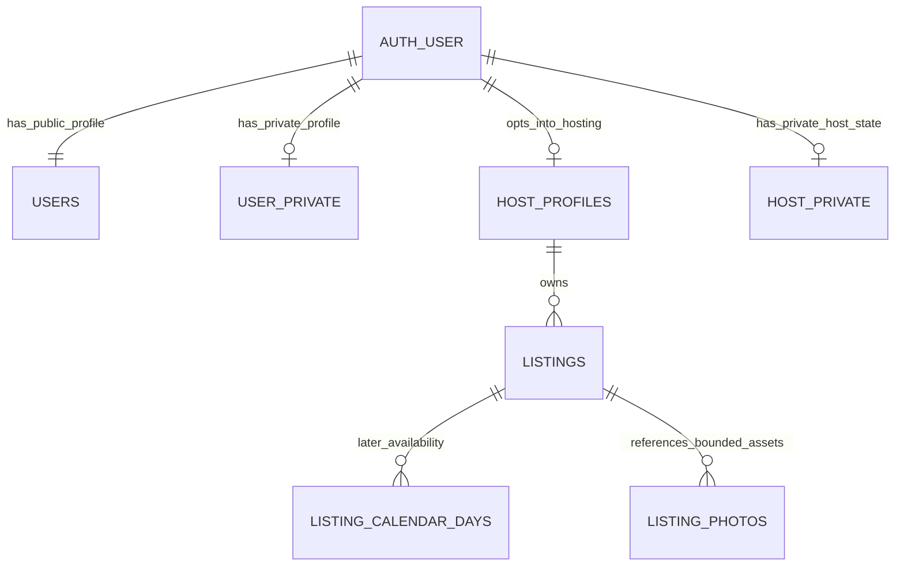
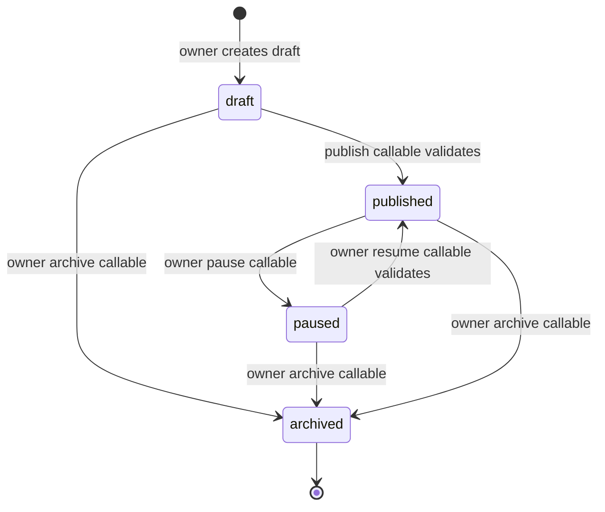

# M3.1 — Host Management Architecture and Design

**Status: architecture proposal; M3.2 host-profile and onboarding behavior is
implemented in the application. Listing, photo, publication, and later
milestone behavior in this document remains proposed and unimplemented unless
explicitly noted.**

This design starts from the repository's current Angular/Firebase implementation
and refines the Phase 0 target for voluntary, no-fee hosting. It does not
authorize production access, deployment, or collection of exact residential
addresses.

## 1. Decisions in this proposal

- One Firebase Auth account can travel and host. A host is not a separate
  account type, and choosing to host does not disable traveller features.
- Host status is represented by a host profile, not by a client-editable
  privilege or Firebase custom claim.
- Hosting is voluntary and free to the traveller: no traveller accommodation
  charge, booking commission, or platform fee is part of this milestone.
- A listing document contains only fields intended to be readable by the
  public when published. Firestore rules cannot hide selected fields from a
  reader of a document.
- Exact residential addresses are not collected, stored, or requested anywhere
  in M3.1. Any later address feature needs a separately approved purpose,
  consent, access, retention, and disclosure policy before implementation.
- Listing status changes are trusted operations. Hosts can request publish,
  pause, resume, or archive actions, but cannot directly write a status field.
- Public listing discovery is bounded and cursor-paginated. Availability and
  dates are not part of M3.1.
- Listing photographs enter a private staging area. A trusted processor
  validates and transforms them before any public object is created.

## 2. Current implementation and architecture conflicts

The existing implementation and Phase 0 document differ in several important
ways. M3 must preserve the behavior and security of existing account flows
while resolving these mismatches deliberately.

| Area | Repository today | M3.1 implication |
|---|---|---|
| `users/{uid}` | A publicly readable, allowlisted user profile containing `uid`, `displayName`, `username`, optional `photoURL`, `bio`, `country`, `city`, and other profile fields. | Treat this as the existing public profile contract. Do not move it, add an address, or weaken its rules as part of host onboarding. |
| `userPrivate/{uid}` | Owner-only private profile; exact top-level keys are allowlisted. | Preserve its existing schema and rules. Host-private state belongs in `hostPrivate/{uid}`; exact addresses are excluded from M3.1. |
| Roles | New users are created with `roles: ['traveller']`. Existing rules make roles immutable to clients, while the TypeScript union already includes `'host'`. | Host participation is independent of `users/{uid}.roles`: do not add `'host'` from the client or use any client-editable role as an authorization signal. Host capability is established by the host profile and verified ownership checks. Preserve the existing role immutability and account-profile rules. |
| Host/listing rules | No host/listing matches exist; unmatched paths are default-deny. | Add narrowly scoped matches before adding client functionality. Preserve `users`, `userPrivate`, and `usernames` rules unchanged unless a separately reviewed dependency requires a change. |
| Indexes | `firebase/firestore.indexes.json` currently has no indexes. | Define indexes from the approved, bounded query shapes before discovery implementation; do not guess an unrestricted search API. |
| Storage | Storage is initialized and connected to the emulator, but `firebase/storage.rules` denies all access. | Keep deny-all until staging uploads, safe publication, and rule tests are ready together. |
| Phase 0 target | `hostProfiles` is described as mixing public host-facing fields and private host state; listing publication goes through Functions. | Keep `hostProfiles/{uid}` strictly public and allowlisted; place host-private state and auditable consent records under `hostPrivate/{uid}`. Never rely on field-level redaction in a shared public document. |

Relevant current files:

- [user.model.ts](../src/app/core/models/user.model.ts)
- [user-profile.service.ts](../src/app/core/services/user-profile.service.ts)
- [firestore.rules](../firebase/firestore.rules)
- [firestore.indexes.json](../firebase/firestore.indexes.json)
- [storage.rules](../firebase/storage.rules)
- [phase-0-architecture.md](./phase-0-architecture.md)

## 3. Firestore collections and relationships



Firestore references are UIDs and document IDs; there are no joins. The
`hostUid` in a listing is immutable after creation. Its value must equal the
authenticated UID for owner writes. It is not accepted as proof of
authorization by itself.

### 3.1 `hostProfiles/{uid}` — public host profile

This document is a public projection only. Its exact allowed fields are
validated on every create/update; private consent and exact location data do
not belong here. The document may contain only these approved public fields.
There is no private/draft host data in this collection. A profile is publicly
readable only when its explicit visibility is `public`; owner reads remain
available for either visibility.

```ts
interface HostProfile {
  uid: string;                  // Must equal document ID.
  displayName: string;          // Public name; may default to users/{uid}.
  introduction?: string;        // 0–500 characters.
  photoPath?: string;           // Optional sanitized public asset path; never a download URL.
  languages: string[];          // Maximum 10, unique, bounded entries.
  visibility: 'private' | 'public';
  createdAt: Timestamp;
  updatedAt: Timestamp;
}
```

Example:

```json
{
  "uid": "auth-uid-123",
  "displayName": "Mina",
  "introduction": "I enjoy sharing local food and neighborhood walks.",
  "languages": ["en", "ja"],
  "visibility": "public",
  "createdAt": "<server timestamp>",
  "updatedAt": "<server timestamp>"
}
```

The existence of a host profile indicates that the user opted into hosting;
it does not grant administrator privileges or change the user's roles.
Anonymous/public profile queries must constrain `visibility == 'public'`;
owner reads are a separate UID-scoped operation. Rules do not filter query
results. The public profile's visibility switch is not an authorization
credential. M3.1 does not require host-profile photo uploads; omit `photoPath`
unless a sanitized public asset pipeline and its path policy are separately
approved. Never copy a tokenized download URL into this field.

### 3.2 `hostPrivate/{uid}` — private host state and consent audit

This owner-only document holds non-public host state and is never joined into
public profile/listing responses. It is not `userPrivate/{uid}` and does not
change that existing user-private schema. A minimal current-consent pointer
(`uid`, current terms version/digest, accepted/withdrawn state, event ID, and
`updatedAt`) is maintained transactionally by trusted code so publication
checks do not scan history. Consent events are append-only records below it:
`hostPrivate/{uid}/consentEvents/{eventId}`. Each event contains only
`eventId`, `uid`, `eventType` (`accepted` or `withdrawn`), `termsVersion`,
`termsDigest`, `recordedAt` (server timestamp), an idempotency key, and the
expected previous event ID. A
withdrawal references the accepted terms version and records a new immutable
event; it does not erase the acceptance history. Callable Functions alone
write these records. The owner may read their own consent history; other
clients cannot read or write it. Event IDs/idempotency keys make retries
auditable without duplicate events. A key is single-use per account across
both acceptance and withdrawal; legacy type-scoped events remain recognized.
The latest event per terms version defines
whether that version is currently accepted; a required newer version must be
accepted again before publication.

Acceptance requests must include the exact terms text and version displayed to
the host; the callable rejects stale clients rather than recording assent to
different terms. A retry succeeds only while its event is the current state.
Each new action must name the current event (or null for no prior event);
transactions reject stale expectations rather than allowing delayed requests to
overwrite newer consent. The host must start a new action after a stale retry.
When terms change, update
the version and text in both client and callable, and update the version and
SHA-256 digest required by the Firestore public-read and write rules together.

The consent callables enforce Firebase App Check outside the Functions emulator
and limit new consent events, including withdrawals, to ten per account in any
rolling hour. Current idempotent retries do not consume quota. The cap can delay
withdrawal until a slot opens. The count and state update are transactional,
using trusted runtime time and Firestore server event timestamps. These controls
do not prevent abuse by many valid accounts. Configure
and verify App Check before deployment, and establish monitoring and additional
account/IP abuse controls before public launch.

Public host names and introductions are free text. The field allowlist excludes
private contact and exact-address fields but cannot guarantee that users will
not type such information into free text. The UI warns against doing so; content
moderation and any stronger disclosure controls remain launch requirements.
Already downloaded public data cannot be recalled after consent withdrawal.
Suspended host profiles are hidden from public reads. The callable permits
verified suspended users with a valid token to withdraw consent, but the
existing sign-in flow signs suspended users out and does not provide a
dedicated withdrawal sign-in flow. Deleted accounts cannot change consent.

The terms version/digest, accepted timestamp, UID, event type, and subsequent
withdrawal history must be retained as an auditable record under an approved
retention policy. Never expose consent events or timestamps in the public
profile. Exact consent language and legal sufficiency require product-owner
approval.

### 3.3 `listings/{listingId}` — public-safe listing

Use an auto-generated Firestore ID. The listing ID is also the document ID;
do not accept a client-selected `hostUid` from an untrusted payload. Create
the draft under the authenticated user's UID and validate that the ID is
well-formed. Drafts remain in this collection but contain only the exact
allowlisted public listing schema below: there are no private fields to
redact, even while a listing is unpublished.

```ts
type ListingStatus = 'draft' | 'published' | 'paused' | 'archived';
type AccommodationType =
  | 'private_room'
  | 'shared_room'
  | 'entire_home'
  | 'other';

interface Listing {
  listingId: string;                // Equal to document ID.
  hostUid: string;                  // Approved public owner identifier; immutable.
  status: ListingStatus;            // Public lifecycle metadata; trusted writes only.
  title: string;                     // 1–100 characters.
  description: string;               // 1–3000 characters.
  accommodationType: AccommodationType;
  countryCode: string;               // ISO 3166-1 alpha-2.
  regionId: string;                  // Curated, non-address destination key.
  approximateLocationLabel: string; // For example, "North Kyoto"; no street/house number.
  guestCapacity: number;              // Integer, 1–16 pending product approval.
  bedrooms: number;                   // Integer, 0–20.
  bathrooms: number;                  // Numeric, 0.5 increments, bounded.
  amenities: string[];                // Allowlisted IDs; maximum 30.
  houseRules: string[];               // Each bounded; maximum 20.
  photoIds: string[];                 // Trusted IDs only; maximum 8.
  createdAt: Timestamp;
  updatedAt: Timestamp;
  publishedAt?: Timestamp;            // Set/changed by trusted lifecycle operation.
}
```

Example:

```json
{
  "listingId": "auto-id",
  "hostUid": "auth-uid-123",
  "status": "published",
  "title": "Quiet room near the old town",
  "description": "A private room in a shared home, with access to the kitchen.",
  "accommodationType": "private_room",
  "countryCode": "JP",
  "regionId": "kyoto-north",
  "approximateLocationLabel": "North Kyoto, Japan",
  "guestCapacity": 1,
  "bedrooms": 1,
  "bathrooms": 1,
  "amenities": ["wifi", "kitchen"],
  "houseRules": ["no_smoking", "quiet_hours"],
  "photoIds": ["photo-01", "photo-02"],
  "createdAt": "<server timestamp>",
  "updatedAt": "<server timestamp>",
  "publishedAt": "<server timestamp>"
}
```

Rules enforce exact keys, types, allowlisted enum values, string bounds,
numeric bounds, and list-size bounds. Avoid arbitrary maps and unbounded
arrays. For amenity/rule vocabulary, the client displays friendly labels but
stores stable approved IDs.

**Never place these fields in `listings/{listingId}`:** street address, unit,
postal address, exact coordinates, access/entry instructions, host email or
phone, private safety notes, or a tokenized Storage download URL. Do not derive
an exact point from a public geohash. Begin with a curated `regionId` and
coarse label; adding map coordinates requires a separate disclosure review.

#### Exact residential address — excluded from M3

No exact residential address field, document path, input, upload, log, or
client cache is part of M3.1. Do not create a placeholder private-location
collection. Any later proposal to collect or disclose an address is a separate
milestone requiring explicit purpose, host consent, access/retention rules,
and security review. Approximate `regionId` and `approximateLocationLabel`
remain the only M3 location data.

### 3.4 Availability — later subcollection

The proposed
`listings/{listingId}/calendarDays/{YYYY-MM-DD}` layout is not needed for M3
listing creation/publication. Before implementing it, choose between per-day
documents and bounded month documents based on query/write requirements. In
either design, no client write may override an active booking; authoritative
date checks and concurrent booking decisions belong in trusted Functions.

## 4. Host onboarding and profile update flows

1. A signed-in, email-verified user chooses **Start hosting**. This is
   independent of traveller onboarding and does not change the user's existing
   profile or roles.
2. Show the no-fee hosting terms and privacy/safety notice. Require explicit
   acceptance; record an immutable event containing the exact terms version,
   terms digest, user UID, and server timestamp under
   `hostPrivate/{uid}/consentEvents/{eventId}`. Provide withdrawal; append an
   auditable withdrawal event rather than deleting the acceptance. Do not imply
   background checks, identity verification, insurance, or safety guarantees
   that do not exist.
3. Create `hostProfiles/{uid}` with bounded allowlisted public fields and
   `visibility: 'private'` initially. Prefer a client write guarded by strict
   owner/schema rules for ordinary public-field edits; use trusted callable
   operations for consent events. Repeated onboarding must be idempotent and
   must not overwrite an existing profile.
4. The owner edits only allowlisted public fields. `uid` and `createdAt` are
   immutable. The host can preview exactly the public representation.
5. A host can leave hosting without losing traveller access. Withdrawal of
   current terms blocks new publication/resumption and triggers the documented
   trusted pause policy for already-published listings. Stopping hosting pauses
   listings through the controlled lifecycle. Any global host-disable operation
   must use bounded server-side batching and failure recovery; do not depend on
   a client loop to hide listings. Host participation does not require adding
   `'host'` to `users/{uid}.roles`.

A route guard may guide navigation, but every read/write and callable operation
must authorize from Firebase Auth UID, document ownership, and validated
document state. Existing account-status checks remain in effect.

## 5. Listing lifecycle



| Transition | Initiator | Required checks |
|---|---|---|
| Create → `draft` | Owner client write or create callable | Auth UID equals new `hostUid`; host profile exists; server timestamps; valid exact schema. |
| `draft` → `published` | `publishListing` callable | Authenticated, email verified, account active; caller owns listing and host profile; current consent exists; listing passes required-field/photo checks; server sets `publishedAt`/`updatedAt`. |
| `published` → `paused` | `setListingStatus` callable or trusted moderation operation | Owner request or authorized moderator; stored owner is checked; operation is idempotent; server writes status and timestamp. |
| `paused` → `published` | `setListingStatus` callable | Same authorization and publication validation as initial publish; current consent is still valid; server refreshes `publishedAt`. |
| `draft`/`paused`/`published` → `archived` | `setListingStatus` callable | Owner request or authorized moderator; caller's authority is checked; cannot bypass later request/booking retention checks. Archived is terminal in this proposal. |
| Any status → deleted | No direct client transition | No hard delete in M3. Use a reviewed retention/deletion process, with trusted cleanup of dependent media. |

**Clients are explicitly prohibited from changing listing status.** Listing
creation may establish only the initial `draft` state under a create rule that
requires `status == 'draft'`; this is not a transition. Firestore rules deny
every subsequent client write that changes `status`, including attempted
transitions through `updateDoc`, batched writes, transactions, or alternate
client endpoints. Clients may invoke only an authenticated callable operation
that expresses an allowed intent; only trusted server code changes status.
Direct client writes must also preserve `publishedAt`, `hostUid`, `listingId`,
`createdAt`, and trusted media IDs. Owners may update validated content fields
while a listing is draft, paused, or published; published content changes are
public immediately. If review is required, add an explicit trusted moderation
state/process rather than a client status shortcut.

The server validates `hostUid` from the stored document, never from a
status-change request payload. For owner requests, it checks Firebase Auth UID
against the stored `hostUid`, active account state, verified email and current
host consent. Moderator actions require a separately defined trusted
moderator authorization (never a client role or request parameter). Enforce
the transition table and idempotency key inside a transaction. A user cannot
publish another host's listing, even if they guess its document ID or call the
Function directly.

## 6. Firestore authorization design

Keep the current `users/{uid}`, `userPrivate/{uid}`, and `usernames/{username}`
matches intact. Add new, narrow matches before the existing default-deny
catch-all. Do not add a permissive wildcard. Suggested rule predicates:

- `isOwner(uid)`: `request.auth != null && request.auth.uid == uid`.
- `isListingOwner()`: authenticated and `resource.data.hostUid == request.auth.uid`.
- `isPublishedListing()`: stored `status == 'published'`; public listing read
  paths never expose non-published documents.
- `validHostProfile(data, uid)`: exact keys, UID/path match, bounded strings,
  bounded unique lists, and timestamp checks.
- `validHostPrivate(data, uid)`: exact private schema; owner reads only;
  consent-event writes are trusted-only and immutable.
- `validListing(data, id)`: exact keys, ID/path match, types, allowlisted
  enums, bounds, and no unknown fields.
- `validListingContentUpdate()`: immutable fields preserved; diff contains
  only approved content keys and `updatedAt`; status and trusted photo IDs are
  unchanged; `updatedAt == request.time`.

Publication and host-terms callables use the Admin SDK, which bypasses rules.
They must therefore repeat all relevant authorization and validation, check
`context.auth`, validate email verification/account status, check current
consent/withdrawal state, apply idempotency and bounds, and write only the
specific permitted fields. Consent acceptance and withdrawal events are
append-only, server-timestamped, versioned and auditable. The callable is not
safe merely because only the app invokes it.

### Authorization matrix

| Resource/action | Anonymous | Signed-in non-owner | Owner | Trusted Function |
|---|---|---|---|---|
| Read `users/{uid}` | Existing public-profile rules | Existing public-profile rules | Existing owner rules | Admin SDK as required |
| Read/write `userPrivate/{uid}` | Deny | Deny | Existing owner/allowlist rules | Admin SDK as required |
| Read host profile | Only `visibility == 'public'` profiles | Same | Own profile for either visibility | Admin SDK as required |
| Query host profiles | Query constrained to `visibility == 'public'` | Same | Own document/get or query constrained to `uid == auth.uid` | Bounded administrative queries only |
| Read/write `hostPrivate/{uid}` | Deny | Deny | Own private state read; no client write to consent audit | Trusted consent/lifecycle operations only |
| Create host profile | Deny | Deny | Strict self-owned profile creation, private visibility by default | Optional validated initialization |
| Update host public fields | Deny | Deny | Allowlisted fields only; UID/createdAt immutable; visibility changes validated | Only specific lifecycle fields |
| Read published listing | Published documents only | Published documents only | Own listing of any status | Admin SDK as needed |
| Query published listings | Query must constrain `status == 'published'`; finite page size/cursor | Same | May use public published query | Bounded administrative queries only |
| Query own drafts/non-public listings | Deny | Deny | Separate query constrained to `hostUid == auth.uid`; finite limit/cursor | Bounded administrative queries only |
| Create listing | Deny | Deny | Own draft only; server timestamps and exact schema | Optional if atomic host/listing provisioning is needed |
| Edit listing content | Deny | Deny | Own listing; allowlisted fields; status and ownership immutable | Photo metadata, if produced by image finalizer |
| Change status/publish/archive | Deny | Deny | Callable intent only; all direct client status writes denied | Validated owner transition or separately authorized moderation |
| Upload staging photo | Deny | Deny | Own listing path, bounded image type/size | Inspect, transform, and publish final object |
| Read final listing photo | Only when parent listing is published and photo is referenced | Same | Published listing rule; owner may view staging | Create/delete sanitized final objects |
| Write/delete final photo | Deny | Deny | Deny | Trusted media cleanup/finalization only |

Firestore rules do not filter query results. Define separate service/query
contracts: public discovery queries always include
`where('status', '==', 'published')`; owner draft/management queries always
include `where('hostUid', '==', auth.uid)` and return only the authenticated
owner's listings. Rules must be able to prove the entire query result is
authorized or reject it; never fetch broadly then filter on the client. Apply
a finite limit (maximum 20 per page for M3.1/M4 proposal) and cursor pagination
to every listing and host-profile list query. Owner direct document gets still
check UID ownership. Add emulator tests for both exact query shapes and
negative unscoped/wrong-owner shapes.

## 7. Public/private data boundary

Firestore rules authorize reads of whole documents; they cannot redact fields.
Therefore:

1. `listings/{listingId}` is a public-safe document by construction. A strict
   exact-key allowlist rejects address/contact/private fields.
2. A public listing query returns only documents with `status == 'published'`.
   Draft, paused, and archived listings are readable only by their owner.
3. Exact residential addresses are not collected or stored anywhere in M3.1;
   no public listing service can return an address.
4. Host profile data is a separate, allowlisted public projection.
   `hostPrivate/{uid}` and its consent audit are owner-only and never share
   public profile/listing documents.
5. Public photo metadata contains approved Storage object paths/IDs, not
   download tokens, local paths, EXIF, GPS, or private URLs.

Do not return raw Firestore documents to components. Map to typed public
listing and owner listing models with explicit field selection.

## 8. Storage access policy for listing photographs

### Paths and processing

```text
listing-uploads/{uid}/{listingId}/{uploadId}    # Private staging originals
listing-media/{listingId}/{photoId}.webp        # Sanitized published variants
```

- **Path and ownership:** Authenticated owners upload only to their own
  listing's staging path. Storage rules verify UID against both the path and
  parent listing's stored `hostUid`; clients cannot create or write
  `listing-media`. Staging is private and is not publicly listable or readable.
  Permit creation of an upload object once; deny client overwrite/delete.
  Retries reuse the same upload ID and unchanged bytes/generation; changed
  bytes require a new upload ID. Final objects use random unguessable IDs, but
  authorization never depends on obscurity of those IDs.
- **Input validation:** The trusted processor inspects file bytes and decodes
  the complete image; MIME metadata/filename extensions are hints, not proof.
  Proposed limits are a maximum 10 MiB source file, JPEG/PNG/WebP input only,
  at least 320 × 240 pixels, at most 12,000 pixels on either edge and 40
  megapixels total, and at most 8 approved photos per listing. Reject animated
  formats, SVG, corrupt/truncated images, unsupported color profiles, and
  decompression-bomb-like inputs. Limit active/in-flight staging uploads to
  8 per listing and enforce limits with trusted state/transactions, not only
  client validation. Output is a normalized WebP with the longest edge at
  most 2,048 pixels; final product approval may tighten these conservative
  proposed limits, but must not omit them.
- **Metadata and transformation:** `finalizeListingPhoto` strips all EXIF,
  GPS, IPTC/XMP and other ancillary metadata, orientation-normalizes, resizes,
  and re-encodes from decoded pixels before writing the final object. It
  rejects any file it cannot safely decode/transform. Do not copy source
  metadata or source bytes verbatim. Public metadata contains only approved
  IDs/paths and safe dimensions/format if required.
- **Retry and idempotency:** The client creates a random `uploadId` and
  idempotency key and uploads to that stable staging path. A trusted upload
  record tracks `pending`, `processing`, `complete`, or `rejected` and binds
  UID, listing ID, source generation/hash, and result. Finalization verifies
  caller ownership, exact object generation and current listing state; retries
  for the same source return the recorded result and never add duplicate
  `photoIds`. Use deterministic processing state and transactionally reserve
  count/capacity. Handle partial failure (final object written but Firestore
  update failed, or vice versa) by reconciling the recorded state and deleting
  unreferenced output; do not report success until both object and listing
  metadata are consistent.
- **Abandoned uploads:** Expire pending upload intents after 24 hours.
  A scheduled trusted cleanup removes expired staging objects and records,
  rejected sources, and orphan final objects not referenced by any listing.
  Cleanup is bounded, paginated, retryable, and idempotent; use object
  generation checks to avoid deleting a newer retry. Alert on repeated cleanup
  failure and cap per-user/per-listing outstanding uploads.
- **Deletion and moderation:** The owner requests deletion by photo ID through
  a callable; the server verifies ownership and reference, removes the ID and
  deletes the final object idempotently. If removal violates publication
  requirements, the same trusted transaction pauses the listing while
  removing the photo reference; object deletion is then safely retried.
  Clients cannot delete or overwrite final objects. Provide a
  report/moderation path; an authorized moderation operation can reject or
  quarantine a photo, remove public reachability, and pause a listing if its
  remaining photos/content no longer qualify. Moderation authorization,
  reason/audit record, reviewer process, and response/appeal policy must be
  approved before public launch. No image is publicly visible before
  successful finalization and reference by a published listing.
- No photo upload during host onboarding is necessary. Validate the first
  version with the same conservative rules and emulator tests.

The numeric image limits above are proposed M3.1 bounds for product/security
approval; implementation must enforce the selected values at Storage ingress,
trusted byte processing, and final metadata commit. If product chooses
different values, update the schema, limits, and tests together before launch.

A final object is readable only when its listing is published and that
`photoId` is in the listing's approved `photoIds`. Paused/draft/archived
photos are not publicly readable through Storage rules. Never store Firebase
`getDownloadURL()` token URLs in Firestore: they are bearer links and can
outlive a publication-state change. Use an access path that enforces Storage
rules on each read (or explicitly design and test token revocation/cache
behavior before exposing such URLs). No photo upload during host onboarding is
necessary.

### Rule policy summary

| Path | Read | Create/update | Delete |
|---|---|---|---|
| `listing-uploads/{uid}/{listingId}/{uploadId}` | Same owner only | Same owner, parent listing owned, bounded size and declared MIME; create-only, trusted processor validates bytes | Trusted cleanup only; client delete denied |
| `listing-media/{listingId}/{photoId}.webp` | Public only if parent status is published and ID is referenced | Trusted finalizer only | Trusted owner-delete/moderation/cleanup only |
| All other paths | Deny | Deny | Deny |

Storage rule tests must cover unauthenticated access, cross-owner paths,
listing-ID substitution, paused/draft publication visibility, oversize and
disallowed content types, overwrites, client deletes, list attempts, and
unreferenced final assets. Processor tests (not Storage rules) must exercise
real/mismatched MIME, corrupt and oversized decoded images, dimensions/pixel
count, unsupported formats, EXIF/GPS removal, output re-encoding, duplicate
and concurrent retries, partial failures, count limits, abandoned cleanup,
deletion and moderation. Rules checking `photoIds` use a bounded list and
parent Firestore lookup; keep the list small and test the exact paths/metadata
against the emulator.

## 9. Angular feature structure

Keep the existing standalone/lazy-loaded architecture and create only the
needed feature files:

```text
src/app/
  core/
    models/
      host-profile.model.ts
      listing.model.ts
    services/
      host-profile.service.ts
      listing.service.ts
  features/
    hosting/
      hosting.routes.ts
      onboarding/
        host-onboarding.component.ts
      profile/
        host-profile-editor.component.ts
      listings/
        host-list.component.ts
        listing-editor.component.ts
        listing-preview.component.ts
        listing-photo-uploader.component.ts
  features/discovery/
    discovery-page.component.ts       # Replace placeholder only in M4.
    listing-detail.component.ts       # M4.
functions/src/
  hosting/
    accept-hosting-terms.ts
    set-listing-status.ts
    finalize-listing-photo.ts
    delete-listing-photo.ts
```

The exact file split may follow existing project conventions. Keep forms
reactive and typed. Services own Firestore/Storage/Callable SDK operations;
components own view state and validation presentation. Add a lazy `/hosting`
route, but rely on Security Rules and Functions—not Angular guards—for
authorization.

## 10. Client transactions versus Cloud Functions

| Operation | Proposed implementation | Reason |
|---|---|---|
| Read/update own host public profile fields | Direct client SDK with exact-key owner rules | Simple self-owned data; no privilege transition. |
| Accept/withdraw hosting terms | Callable Function | Append a versioned, timestamped, owner-bound audit event under `hostPrivate/{uid}`; enforce idempotency; withdrawal blocks future publish/resume and invokes the trusted pause policy. |
| Create a draft listing | Direct client write or small transaction | Safe if rules require caller-owned `hostUid`, `status == 'draft'`, exact schema, valid host profile, and server timestamps. A client-supplied ID is not a security problem if ownership is enforced; auto-ID is preferred. |
| Edit listing content | Direct client update or transaction | Safe with immutable ownership/status fields, exact allowlist, bounds, and owner checks. For multi-document profile/listing changes, use a transaction. |
| Publish/pause/resume/archive listing | Callable Function | Centralizes lifecycle transition validation, stored-owner checks, verified/active account and current-consent checks, required photos/content, server timestamps, idempotency, and future dependent-record checks. Rules deny all direct client status changes. |
| Upload source image | Direct client Storage SDK to private staging | Storage rules can bound ownership, path, size, and declared MIME type; no public object is created. |
| Inspect/transform/finalize/delete image | Callable/Task Queue Function | Actual bytes, dimensions/count/format/size limits, EXIF/GPS removal, random IDs, trusted metadata and final-object writes cannot be trusted to the browser. Use bounded execution, idempotent retries, orphan/abandoned cleanup and audited moderation/deletion. |
| Maintain future calendar/availability | Trusted Function for authoritative changes | Must coordinate with booking conflict checks and enforce bounded date ranges. Not part of M3.1 implementation. |
| Read public discovery pages | Direct client query with indexes/cursors | Public read-only data; query must enforce `status == 'published'` and finite page size. |

Admin SDK calls bypass Firestore and Storage rules. Each Function must
authenticate, authorize against stored ownership (or an explicitly approved
moderator identity), validate all inputs, enforce limits, be idempotent where
retried, and avoid returning private fields.

## 11. Composite index plan

There are no current composite indexes. Indexes should be added only for
approved query contracts; Firestore single-field indexes do not require
manual declarations. Rules do not filter query results, so every query shape
must prove authorization through its predicates. Proposed M3.1/M4 query
contracts and bounds:

- Public listing discovery: `status == 'published'`, finite `limit` no greater
  than 20, and cursor (`startAfter`) pagination. Never load all listings.
- Owner listing management/drafts: `hostUid == auth.uid`, finite limit no
  greater than 20, cursor pagination, then any additional status filter.
- Public host profile discovery: `visibility == 'public'`, finite limit no
  greater than 20, cursor pagination. Owner profile access is a direct
  owner-scoped get or `uid == auth.uid` query.
- Owner consent-audit history: query
  `hostPrivate/{uid}/consentEvents` by `recordedAt DESC`, with a finite limit
  no greater than 20 and cursor pagination. Trusted publication checks read
  the bounded current-consent pointer on `hostPrivate/{uid}` rather than
  scanning event history.
- No query may fetch an unrestricted collection and filter status/owner in
  client memory. Direct `get` rules still check the individual document.
- Destination uses one canonical `regionId` equality filter (rather than
  unbounded text search or arbitrary geospatial queries).
- Optional filters are `accommodationType == ...` and
  `guestCapacity >= requestedGuests`.
- Results have stable cursor ordering by a trusted timestamp plus document ID;
  use `publishedAt` for recency only if product approves recency as the sort.
- Every query has a finite page size and a `startAfter` cursor. No client-side
  full collection scan.

Candidate composite index families to validate against the exact Firestore
query in an emulator before adding to `firebase/firestore.indexes.json`:

| Query shape | Candidate fields (ascending unless noted) |
|---|---|
| Browse published listings | `status`, `publishedAt DESC` |
| Destination browse | `status`, `regionId`, `publishedAt DESC` |
| Destination + accommodation type | `status`, `regionId`, `accommodationType`, `publishedAt DESC` |
| Destination + guest capacity | `status`, `regionId`, `guestCapacity`, `publishedAt DESC` |
| Destination + accommodation type + guest capacity | `status`, `regionId`, `accommodationType`, `guestCapacity`, `publishedAt DESC` |
| Owner listing management | `hostUid`, `updatedAt DESC` (add `status` only for an approved filtered owner view) |
| Public host-profile browse, if enabled | `visibility`, `displayName` or approved stable ordering field |

Firestore may require a different field order or an explicit ordering on the
inequality field for the selected SDK/query version. Treat the emulator's
missing-index diagnostic and the approved query matrix as the source for final
definitions. Do not add speculative permutations, index exact-address fields,
or implement full-text search with Firestore indexes. Availability-aware
queries need a separate design. Count document reads per page and per user
flow, avoid N+1 host/photo lookups by embedding only bounded public
presentation data or fetching by bounded IDs, and define an explicit
read/cost budget before launch. Functions and cleanup workers must paginate
with finite batch sizes; never use unbounded collection scans.

## 12. Security risks and mitigations

| Risk | Mitigation |
|---|---|
| Client forges `hostUid` or publishes another user's listing | Bind owner to `request.auth.uid`; immutable `hostUid`; status changes through a Function that loads the stored listing and checks owner. Test cross-user and guessed-ID attempts. |
| Host privilege escalated through `users.roles` | Preserve immutable existing roles; do not authorize from a client role array. Host ownership is established by `hostProfiles/{uid}` and stored listing UID. |
| Host consent/private state leaks publicly | Keep host consent and non-public state only in owner-only `hostPrivate/{uid}`; append immutable trusted consent events and test public denial. |
| Address leaks through a public document | Exact residential addresses are excluded from M3.1; strict public exact-key allowlists reject address fields and tests attempt injection. Avoid precise public coordinates and geohashes. |
| Rules treated as field filters | Separate public and private documents; Firestore rules cannot redact fields. Public listing schema contains public fields only. |
| Draft/paused listings become public | Public query/read rules require published status; owner access is separate. Test direct get and query behavior for every state. |
| Client bypasses lifecycle controls | Deny direct changes to status, `publishedAt`, host identity, and trusted media IDs; validate all callable operations server-side. |
| Fake image/MIME, EXIF GPS, harmful image, or Storage abuse | Private staging; byte-level decode/validation, explicit size/format/dimension/count limits, metadata stripping, resizing/re-encoding, idempotent finalization/cleanup, client-denied final writes/deletes, and report/moderation process. |
| Storage download token remains usable after pause | Do not persist bearer download URLs. Enforce rule-evaluated reads or design token revocation and caching before launch. |
| Unbounded reads, lists, and cost | Separate published public queries from UID-scoped owner queries; use required predicates, finite limits/cursors, bounded document reads/worker batches, bounded arrays/documents, and read/cost acceptance tests. |
| Stale or overly broad account state | Callable checks current account/profile status and email verification; route guards are UX only. Define behavior for suspended/deleted users. |
| User-generated content abuse or unsafe hosting claims | Clear house-rule/content policy, reporting and moderation ownership before public launch; no unsupported safety or verification claims. |
| Host stops hosting but listings remain visible | Pause each listing through trusted transition; if adding global host pause, design an atomic visibility gate and recovery procedure rather than a client-side batch. |

## 13. Implementation stages and test plan

Implement and approve one stage at a time. M3.1 is design only.

### Stage 1 — Approve public/private schema and consent

- Confirm host-profile visibility and terms acceptance requirements.
- Define the immutable consent event version/digest, idempotency, withdrawal
  handling, retention, and audit access policy.
- Confirm public profile fields and whether display name/photo may be reused from
  `users/{uid}`.
- Approve allowed listing categories, capacities, dimensions, amenities, rules,
  content/photo limits, and region identifiers.
- Record exact residential addresses as explicitly out of scope for M3.1.
- Acceptance: signed-off data dictionary, field bounds, terms version, and
  privacy classification; no existing profile/username rules changed.

### Stage 2 — Host opt-in and profile

- Add typed host models/service and isolated `/hosting` onboarding/profile UI.
- Add owner-only `hostPrivate/{uid}` state and immutable consent-event
  callables, plus strict public host-profile rules.
- Add focused Angular service/component tests and Firestore emulator tests.
- Acceptance: a traveller can remain a traveller without a host profile; a
  user can start hosting without changing `users/{uid}.roles`; another UID
  cannot read private consent or edit host data; consent accept/withdraw retries
  are idempotent and audit history is retained.

### Stage 3 — Listing drafts and editable fields

- Add listing model/service/editor/preview and draft listing CRUD.
- Add exact-key Firestore rules, bounds, owner query shape, and default-deny
  preservation.
- Acceptance: owner creates multiple drafts, edits allowed fields, and cannot
  edit `hostUid`, status, timestamps, or trusted photo IDs; non-owner cannot
  read drafts or write any listing. Public documents contain only the approved
  listing fields, including when status is not published.

### Stage 4 — Controlled lifecycle

- Add callable publish/pause/resume/archive operations and server-side
  validation.
- Add required-content/photo readiness checks and safe error mapping.
- Acceptance: only the stored owner can request valid transitions; callers
  cannot publish another host's listing or bypass required fields; invalid,
  repeated, and out-of-order transitions are rejected or idempotently handled;
  direct client status writes fail.

### Stage 5 — Safe photo pipeline

- Add private staging uploads, Storage emulator rules tests, image validation
  and transformation, bounded public photo IDs, idempotent retry/reconciliation,
  abandoned-upload cleanup, owner deletion, and audited moderation.
- Acceptance: no unauthenticated/cross-owner upload, final-object write, or
  unpublished photo read; rejected images produce no public object; published
  image bytes are re-encoded with EXIF/GPS and other metadata removed; exact
  size/format/dimension/count limits are enforced; retry/cleanup/deletion is
  idempotent and does not expose a false success.

### Stage 6 — M4 public discovery (separate milestone)

- Implement public listing queries, the agreed index set, pagination, and
  listing detail screens. Do not add date availability until that model is
  approved.
- Acceptance: anonymous and authenticated users can query only published
  listings; results are bounded and stable; direct reads of draft/paused/
  archived listings fail for non-owners; no private location/address is
  returned.

### Required test layers

**Unit tests**

- Host/listing schema validators reject missing, extra, malformed, oversized,
  and out-of-range values.
- Services construct only allowed updates and map expected callable/storage
  errors without swallowing failures.
- UI tests cover host opt-in consent, multiple listings, validation, lifecycle
  controls, visible loading/error/success states, and traveller navigation
  unaffected by hosting.
- Function tests cover stored-owner authorization, account/email gates,
  lifecycle transitions, idempotency, photo processing failures, and retry
  behavior.

**Firestore Emulator rules tests**

- Preserve the current profile/username rule suite unchanged and passing.
- User compatibility: existing `users/{uid}`, `userPrivate/{uid}`, and
  `usernames/{username}` behavior and validation remain unchanged; host
  participation neither changes roles nor relies on a client role to authorize.
- Host profile/private state: public reads only for `visibility == 'public'`;
  owner can get own private-visibility profile; unauthorized and cross-UID
  public/private access is denied; UID/createdAt mutation and invalid/extra
  keys are denied; `hostPrivate/{uid}` and consent events are unreadable by
  other users and publicly, while client create/update/delete of audit events
  is denied.
- Consent callables: version/digest and server timestamps are recorded;
  duplicate idempotency keys do not duplicate events; withdrawal appends
  history, updates the current-consent pointer, blocks publish/resume, and
  cannot erase prior acceptance. Consent history queries are owner-scoped,
  paginated, and limited to 20 events per page.
- Listings: public read only for published documents; owner read for all own
  statuses; cross-owner read/write denial; forged host UID denial; status,
  publishedAt, and trusted photo ID direct-write denial; field injection
  (including residential address, exact coordinates, email/phone, download
  tokens, and unapproved fields) denial; invalid bounds and malformed arrays
  denial. Confirm public listing documents contain only the approved field set.
- Queries: public query constrained by `status == 'published'` succeeds;
  owner query constrained by `hostUid == auth.uid` succeeds; unscoped and
  wrong-owner queries that could return unauthorized documents fail. Verify
  separate public/owner service query construction, finite 20-document
  maximum, cursors, and read budgets in service tests. Do not assert that
  rules filter an unfiltered query.
- Lifecycle bypass: direct status writes fail via update, set/merge, batches,
  and transactions; client creation with any status other than `draft` fails;
  direct changes to `publishedAt`, ownership, timestamps, and photo IDs fail.
  Callable tests cover unauthenticated callers, wrong owner/guessed listing
  ID, invalid/out-of-order transitions, revoked consent, suspended/unverified
  users, unauthorized moderation, and safe retries.

**Storage Emulator rules tests**

- Unauthorized/anonymous access, cross-user ownership, mismatched listing
  path, listing-ID substitution, staging list/read/write by non-owners, and
  host ownership mismatch are denied.
- Declared disallowed MIME type and oversize objects, staging overwrites, and
  client delete behavior are denied; clients cannot create/overwrite/delete
  final paths.
- Final path public read succeeds only for a published listing and referenced
  photo ID; draft/paused/archived and unreferenced objects are inaccessible.
- Processor tests—not Storage rules—prove real byte-format validation,
  dimensions/pixel-count/file-size/photo-count limits, corrupt image rejection,
  EXIF/GPS/IPTC/XMP removal, orientation normalization, and sanitized
  re-encoding.
- Function/storage integration tests cover duplicate/concurrent retry,
  partial failures, orphan cleanup, 24-hour abandoned staging cleanup,
  generation-safe deletion, owner photo deletion, report/moderation
  quarantine, and safe pause when publication requirements are no longer met.

## 14. Decisions requiring product-owner approval

1. **Host public profile visibility:** Is the host profile public immediately
   on opt-in, only after first published listing, or controlled by a separate
   visibility choice?
2. **Consent and host eligibility:** What terms/policy version and digest must
   be accepted? What audit retention applies, how is withdrawal handled for
   published listings, and is verified email sufficient to publish? Are there
   launch geography, age, or eligibility restrictions?
3. **Account lifecycle:** What should happen to listings when an account is
   suspended, deleted, or stops hosting? Who can restore or permanently close
   them?
4. **Listing content vocabulary and bounds:** Approve accommodation types,
   maximum guests/rooms/bathrooms, amenity/rule IDs, text limits, photo count,
   image size/dimensions, and supported formats. Proposed photo caps are 10
   MiB, JPEG/PNG/WebP input, minimum 320 × 240, maximum 12,000 pixels per edge
   and 40 MP, 8 photos per listing and 2,048-pixel output edge.
5. **Location precision:** Approve `regionId` source and display granularity.
   Are any map pins or geohashes needed? This proposal recommends no precise
   public coordinates in M3/M4.
6. **Photo visibility and retention:** Confirm whether photos are accessible
   to anyone while a listing is published, what happens to cached/previously
   fetched photos when paused, and when staging/final media is deleted.
7. **Publication policy:** Is content immediately publishable after server
   validation, or is human review required? Define reporting and moderation
   ownership before public launch.
8. **Host pause/archive semantics:** Can hosts pause at any time? Can an
   archived listing be restored? How should future requests/bookings constrain
   pause or archive once those features exist?
9. **No-fee hosting language:** Approve the exact statement that hosting is
   unpaid and no accommodation fee, commission, or platform fee is charged;
   clarify whether non-monetary exchanges are permitted or out of scope.
10. **Firestore discovery contract:** Approve the sort order, page size,
    destination taxonomy, supported filters, read budget, and expected
    query/cost budgets before finalizing composite indexes.

## 15. Scope boundary

This M3.1 proposal does not implement host/listing code, alter existing Firestore
or Storage rules, add indexes, change the existing roles/profile model, access
Firebase, run inventory/migration utilities, deploy, or authorize collection of
production data. Each implementation stage requires its own review, emulator
tests, and approval.
