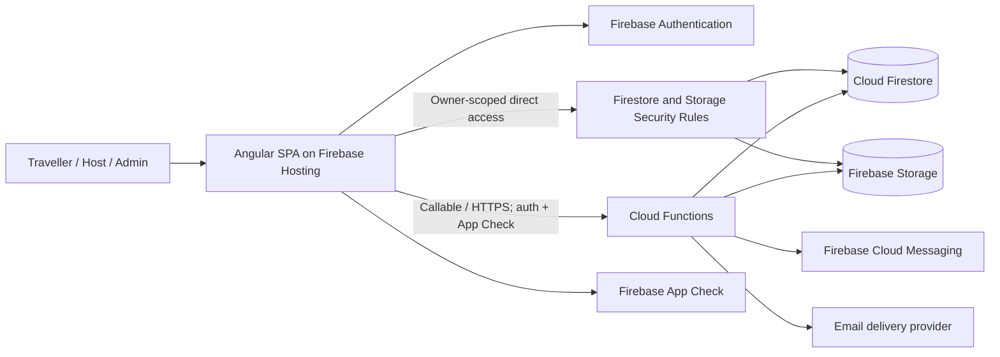
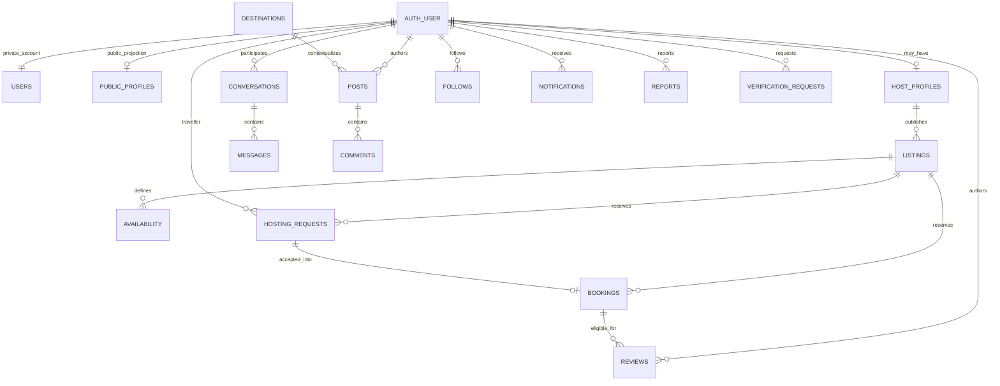

# Openstay — Phase 0 Product and Architecture

**Status:** Proposed; awaiting product and architecture approval
**Scope:** Planning only. No application code, Firebase configuration, rules, or migrations are included.
**Required stack:** Angular, TypeScript, Firebase Authentication, Cloud Firestore, Firebase Storage, Cloud Functions, Firebase Hosting, Firebase Cloud Messaging, App Check, and Firebase Emulator Suite.

This document describes proposals, not the current API contract. For the
implemented request schema, callables, host decisions, security rules, and
deferred behavior, see
[listing and request architecture](./listings-and-hosting-requests-architecture.md#m41-hosting-request-foundation).

## 1. Executive recommendation

Build Openstay as a responsive, PWA-ready Angular single-page application with
standalone, lazy-loaded feature routes and a modular Firebase backend. Use the Firebase
modular Web SDK consistently (rather than mixing AngularFire and direct SDK
patterns). Keep simple, owner-scoped reads and writes in typed data services;
route privileged, multi-document, or security-sensitive operations through
Cloud Functions. Firestore Security Rules—not route guards—remain the access
control boundary for direct client access.

Start with the host–traveller loop: accounts, privacy-aware profiles, hosting
listings, discovery, availability, requests, bookings, participant messaging,
verification, and post-stay reviews. A host acceptance creates a confirmed
booking through a trusted function and a conflict-safe transaction. Do not add
payments, identity-document collection without an approved provider and policy,
community feed/stories, maps, or AI to the MVP.

**Architecture decision:** Firebase is the mandated platform. Firestore is the
primary data store; there is no separate Java backend, SQL database, or custom
REST API in the initial architecture. Cloud Functions are the trusted backend
boundary, not a second general-purpose web server. The exact Angular, Firebase
SDK, Functions runtime, and Angular Material versions will be selected at
implementation time from supported stable releases and pinned in lockfiles.

### Decisions at a glance

| Area | Phase 1 recommendation |
|---|---|
| Web application | Latest stable Angular, standalone components, strict TypeScript, SCSS, PWA-ready |
| UI | Angular Material with a small Openstay theme and accessible feature components |
| Client state | Signals for local/shared UI state; RxJS for Firebase streams and asynchronous composition |
| Firebase integration | Firebase modular SDK, initialized once behind typed providers/services |
| Database | Cloud Firestore with explicit document boundaries, bounded queries, and reviewed composite indexes |
| Trusted operations | TypeScript Cloud Functions with Authentication and App Check enforcement |
| Media | Firebase Storage with private-by-default paths and scoped rules |
| Deployment | Firebase Hosting for the Angular build; Functions deployed separately |
| Authentication | Firebase Auth; claims set only by trusted administration/functions |
| Testing | Angular unit/component tests, Functions tests, Firestore/Storage Rules tests, Emulator Suite integration tests |
| MVP | Profiles, host listings, discovery, availability, requests/bookings, participant messaging, host verification workflow, eligible reviews, notifications, and safety/admin tools |
| Later phases | Community feed, stories, destinations and follows (V2); AI recommendations and group travel (V3) |
| Deliberate exclusions | Payments, public address disclosure, unapproved identity-document storage, public pre-request messaging, maps, and AI/group travel in MVP |

## 2. Product requirements

### Product goals

1. Help travellers find people and places through local hosts.
2. Let hosts describe their hospitality, availability, and local context.
3. Make respectful hosting requests clear and safe for both parties.
4. Build trust through transparent profiles, request states, privacy controls,
   and a staffed reporting process.
5. Keep Openstay community-centered rather than presenting it as a hotel-booking
   or payments marketplace.

**Product definition:** Openstay helps people experience destinations through
local communities, connecting travellers and hosts for stays and cultural
exchange.

**Core value proposition:** Travellers discover local hosts, experience local
culture, connect with people, find unique stays, and share travel stories.
Hosts welcome travellers, share local culture, build a travel community, offer
accommodation, and build reputation. The product serves travellers, hosts, and
communities interested in cultural exchange.

**Primary journeys**

- **Traveller:** register; complete a profile; explore listings and availability;
  send a hosting request; communicate with the host; receive confirmation;
  complete the stay; leave a review.
- **Host:** register; complete a host profile and verification workflow; create
  a listing and availability calendar; receive requests; accept or reject;
  communicate with the traveller; complete the stay; receive a review.
- **Administration:** manage users; review host verification; moderate content
  and safety reports; monitor platform analytics. Admin access and actions are
  restricted and audited.

### MVP scope

**Included**

- Public landing page, browseable published listings, and privacy-filtered host
  and listing details.
- Email/password registration, email verification, sign-in/out, and password
  recovery through Firebase Authentication.
- One account can travel and host; hosting is an optional profile/capability.
- Traveller profile, host profile, and listing create/edit/publish/pause flows.
- Listing photos uploaded to Firebase Storage with type, size, ownership, and
  visibility controls.
- Search by destination, date range, and guest count; pagination and a small set
  of bounded filters.
- Create, view, cancel-pending, accept, and reject hosting requests.
- Set and manage listing availability; search results may be approximate, with
  authoritative availability checked when a request is made and accepted.
- On acceptance, create a booking with conflict checks in a trusted,
  idempotent Function.
- Manage upcoming and past bookings through approved cancellation and
  completion flows.
- Participant-only messaging for a hosting request/booking, with reporting and
  abuse controls.
- Host verification request, status, and admin decision workflow. Evidence
  collection is disabled until provider, consent, access, and retention policies
  are approved.
- Eligible post-stay reviews, subject to booking completion, one review per
  eligible author/booking, and moderation.
- In-app notifications and essential email notifications for account/request
  events. Push notification permission is opt-in and not required for MVP.
- User/listing/message/review reports and protected admin workflows for user
  management, verification, moderation, and platform analytics.
- Responsive, accessible UI with loading, empty, error, and success states.
- PWA-ready delivery, with offline mutations and booking actions disallowed
  unless separately designed and validated.

**Explicitly out of MVP**

- Payments, deposits, commissions, refunds, pricing, or financial ledgers.
- Instant booking; a host must accept a request.
- Public messaging or messaging before a hosting request exists.
- Public exact addresses, map search, or geocoding.
- Identity-document collection until a provider, consent, legal basis, access,
  retention, and incident procedures are approved.
- Posts, comments, likes, follows, destination communities, or travel stories.
- Native mobile apps, AI recommendations, translation, and group travel.
- A custom REST API, SQL database, microservices, or a separate search engine.

### Functional requirements and acceptance outcomes

| ID | Requirement | MVP acceptance outcome |
|---|---|---|
| F-01 | Account lifecycle | A user can register, verify email, authenticate, sign out, and recover access |
| F-02 | Profiles | A user can edit profile fields and understand what is publicly visible |
| F-03 | Hosting | A host can create, edit, publish, pause, and deactivate a listing |
| F-04 | Discovery | A traveller can browse published listings and page through bounded results |
| F-05 | Availability | A host can maintain availability; request/accept actions validate the authoritative calendar |
| F-06 | Hosting requests | A traveller can request a date range and guest count with an introduction |
| F-07 | Host decision | A host can accept or reject a pending request |
| F-08 | Request lifecycle | A traveller can cancel a pending request; participants see current status |
| F-09 | Booking integrity | Concurrent acceptances cannot create overlapping active bookings for a listing |
| F-10 | Booking management | Participants can view booking state and use approved cancellation/completion flows |
| F-11 | Messaging | Only request/booking participants can message; users can report abusive content |
| F-12 | Verification | Hosts can submit a request and see status; authorized admins can decide and audit it |
| F-13 | Reviews | Eligible participants can submit one post-completion review; moderation controls publication |
| F-14 | Notifications | Users can see essential in-app request, booking, and message updates; email delivery is attempted |
| F-15 | Safety/admin | Users can report a user/listing/message/review; authorized admins can manage users, moderate, and resolve reports |
| F-16 | Authorization | Unauthorized users cannot read private data or invoke admin operations |

### Non-functional requirements and launch gates

- **Security:** Default deny, least privilege, server-side validation, App Check,
  explicit object ownership, rate/abuse controls, and security-rule tests.
- **Privacy:** Minimize collection; public APIs expose allowlisted fields only.
  Exact addresses, private contact details, reports, and verification material
  are not public. Define retention/deletion before launch.
- **Reliability:** Critical state transitions are idempotent and transactional.
  Functions and Firestore errors are surfaced; no silent success-shaped fallback.
- **Performance:** Agree on measurable budgets before production testing.
  Baseline targets: primary route LCP below 2.5 seconds on a representative
  mobile connection, and bounded discovery queries that return within the
  agreed product SLO at expected MVP load.
- **Accessibility:** Target WCAG 2.2 AA for primary flows; validate keyboard
  use, focus management, contrast, labels, and screen-reader status updates.
- **Maintainability:** Feature-oriented Angular code, typed service contracts,
  rules/indexes under version control, emulator tests, and operational docs.
- **Portability:** Do not rely on Firestore as an unexportable source of truth
  for irreplaceable business data; document export and recovery procedures.

These are launch requirements, not claims about the current repository.

## 3. Application and Firebase architecture

### System context and trust boundaries



- The browser is an untrusted client. Client validation improves UX but never
  substitutes for Security Rules or Function validation.
- Firebase Authentication establishes identity. Firestore and Storage rules
  enforce direct client access based on `request.auth`, claims, ownership, and
  document state.
- Admin SDK calls in Functions bypass Firestore and Storage rules. Every
  Function must independently validate identity, authorization, input, and
  relevant document state.
- App Check helps establish that requests originate from the expected app; it
  is not user authentication or authorization.
- Public content is limited to explicit public-profile and published-listing
  documents. Never expose private fields in the same document that anonymous
  users can read.
- Functions secrets are managed with the platform secret manager; no privileged
  secrets or service-account credentials ship in the Angular bundle.
- Use emulator, staging, and production Firebase projects. Production data is
  not copied into local development.

### Angular architecture

- Use standalone components and lazy-loaded route trees; no new NgModule-based
  feature architecture.
- Keep pages and UI components separate from typed domain models and
  data-access services. Components do not issue scattered Firestore queries.
- Use Signals for view state, selections, and derived local state. Use RxJS for
  Auth/Firestore listeners, cancellation, and async composition; convert at
  component boundaries with Angular-supported interop.
- Use Reactive Forms with typed controls and client-side validation. Repeat all
  trust-boundary validation in rules or Functions.
- Centralize Firebase initialization, auth state, error mapping, and
  environment configuration. Never put secrets in `environment.ts`; Firebase
  client configuration is not a secret, but access is protected by rules and
  App Check.
- Use Angular Router guards for navigation UX only. Guards are not security
  controls.
- Keep real-time listeners limited to screens that need them, unsubscribe with
  component/service lifecycle, and avoid unbounded snapshots.
- Use Angular Material as the accessible component foundation, themed through
  SCSS tokens and shared design primitives. Avoid a large custom component
  framework.
- Prepare an installable PWA shell and responsive experience. Do not promise
  offline booking, messaging, or other mutations; any offline data behavior
  needs an explicit privacy and consistency design.

### Backend/function architecture

Group Functions by bounded business capability rather than building a general
REST server:

1. **Identity/admin provisioning:** trusted custom-claim management and
   administrative account actions; no public role escalation.
2. **Hosting:** publish/pause validation and safe listing lifecycle operations.
3. **Requests/bookings:** request creation, acceptance/rejection/cancellation,
   conflict checks, and booking creation.
4. **Notifications:** in-app records and delivery orchestration for email/push.
5. **Safety:** report intake validation, moderation actions, and audit records.
6. **Media:** optional upload finalization/metadata validation and cleanup.
7. **Scheduled maintenance:** retention, expiry, and cleanup jobs with bounded
   batches and observable outcomes.

Prefer callable Functions for authenticated app actions. Use HTTPS Functions
for webhooks or external integrations with signature verification. Use
Firestore-triggered Functions only for derived, retry-safe work; triggers are
at-least-once and must be idempotent. Do not perform a critical booking
transition asynchronously after returning a success response.

## 4. Firestore data model

### ER-style relationship diagram



In Firestore, relationships are references/IDs, not SQL joins. Prefer
subcollections for data with a clear parent and access boundary (for example
messages, availability, comments, notifications, and follows). A relationship
may appear in both parties' queries through a bounded collection-group query or
carefully maintained projection only when query needs justify that duplication.
Do not duplicate sensitive data in a public document.

### Common document conventions

- Firebase Auth UID is the stable user key. Other document IDs use Firestore
  auto IDs unless a deterministic ID prevents duplicate relationships.
- Store creation/update instants as server timestamps. Store travel dates as
  `YYYY-MM-DD` strings with explicit half-open `[checkIn, checkOut)` semantics;
  validate calendar correctness in Functions.
- Every document has an explicit schema version only where migrations require
  it; avoid copying redundant derived values without a documented owner.
- Keep document size below Firestore limits with margin. Paginate arrays into
  subcollections; do not store growing message/comment histories in parent docs.
- Use allowlisted data transfer models. Do not expose raw Firestore documents
  directly to UI or anonymous clients.
- For deletion, disable or anonymize user access first, then apply documented
  retention and cleanup policies. Preserve records required for safety,
  disputes, or legal obligations without retaining unnecessary personal data.

### Collection schemas and access matrix

The following defines the initial logical schema. `Required` fields are
required when the document is created; `Optional` fields may be absent. System
timestamps and lifecycle fields may be server-managed. Any schema change must
update the TypeScript model, rules/Function validation, indexes, and tests.

#### `users/{uid}` — private account record

- **Required:** `uid: string`, `email: string` (or omit if not needed after
  Auth migration), `accountState: "active" | "suspended" | "deletionPending"`,
  `createdAt: Timestamp`, `updatedAt: Timestamp`.
- **Optional:** `locale: string`, `notificationPreferences: map`, `deletionAt:
  Timestamp`, `lastProfileReviewAt: Timestamp`.
- **Owner/access:** user may read a restricted allowlist and update only
  permitted preference fields; trusted Functions/admin may read/update the
  private record. Never public-readable. Do not use this document as a public
  profile. Auth email/password remain Firebase Auth's responsibility.
- **Queries/indexes:** exact document lookup by UID; admin account workflows
  only via privileged Functions, paginated and audited.
- **Validation/retention:** UID must equal path UID; allowed preference keys
  only. Remove or anonymize personal fields on approved deletion; retain only
  legally/operationally justified records.

#### `publicProfiles/{uid}` — explicit public projection

- **Required:** `uid: string`, `displayName: string`, `visibility:
  "public" | "members"`, `createdAt: Timestamp`, `updatedAt: Timestamp`.
- **Optional:** `photoPath: string`, `bio: string`, `homeRegion: string`,
  `languages: string[]`, `interests: string[]`, `profileCompleteness: number`.
- **Owner/access:** anonymous read only when visibility is public; signed-in
  read for members visibility; owner edits validated allowlisted fields. No
  email, legal name, phone, exact address, birth date, or private safety data.
- **Queries/indexes:** direct UID reads; avoid broad listing/search over user
  profiles. Discovery queries use published listings, not this collection.
- **Validation/retention:** bounded strings/arrays and approved image paths.
  On account deletion, remove or anonymize public content per deletion policy.

#### `hostProfiles/{uid}` — host-facing public profile and private host state

- **Required:** `uid: string`, `state: "draft" | "active" | "paused" |
  "closed"`, `createdAt: Timestamp`, `updatedAt: Timestamp`.
- **Optional:** `introduction: string`, `hostingPreferences: map`,
  `languages: string[]`.
- **Owner/access:** owner can read/write their profile; public/member reads only
  an allowlisted projection when active. Prefer splitting private verification
  state into `verificationRequests`. A public verification badge, if approved
  by policy, is a trusted allowlisted projection and never exposes pending or
  rejected status. Admin reads are audited.
- **Queries/indexes:** UID lookup; public listing discovery should not require
  scanning host profiles.
- **Validation/retention:** trusted Functions set lifecycle/verification
  status. No unsubstantiated “verified” badge. Remove personal data on
  deletion according to policy.

#### `listings/{listingId}` — accommodation and hosting offer

- **Required:** `listingId: string`, `hostUid: string`, `status: "draft" |
  "published" | "paused" | "inactive"`, `title: string`, `description:
  string`, `region: string`, `countryCode: string`, `accommodationType:
  string`, `guestCapacity: number`, `createdAt: Timestamp`, `updatedAt:
  Timestamp`.
- **Optional:** `photoPaths: string[]`, `languages: string[]`, `facilities:
  string[]`, `houseRules: string[]`, `approximateGeohash: string`.
- **Owner/access:** anyone may read only published, privacy-filtered listings;
  host owner reads all own listings and edits draft fields. Publishing and
  state transitions go through Functions. Exact street address/contact details
  are excluded and stored privately only if a later approved feature needs them.
- **Queries/indexes:** public discovery by `status`, country/region, optional
  accommodation type, and deterministic sort; filter by guest capacity.
  Date availability is verified authoritatively when submitting/accepting,
  not inferred from a potentially stale search result. Paginate with cursor.
- **Validation/retention:** `hostUid` immutable after creation; capacity and
  content bounds validated; photo paths must belong to host. Deactivate or
  delete on account closure only after dependent requests/bookings are handled.

#### `listings/{listingId}/availability/{yyyy-MM}` — host calendar

- **Required:** `days: map<string, "open" | "closed">`, `updatedAt: Timestamp`.
  Keys are zero-padded day numbers (`"01"`–`"31"`); an omitted day is closed.
- **Optional:** none.
- **Owner/access:** host reads and updates their own calendar through a Function;
  discovery reads only what is needed to evaluate candidate dates. Booking
  state remains authoritative in `bookings`, not duplicated as calendar state.
- **Queries/indexes:** direct month-document reads for the requested date
  range; validate calendar dates and bound the maximum stay length.
- **Validation/retention:** server checks the listing owner and valid month/day
  keys. Opening dates cannot override an active booking or blocked safety state.

#### `hostingRequests/{requestId}` — request and host decision

- **Required:** `requestId: string`, `listingId: string`, `hostUid: string`,
  `travellerUid: string`, `checkIn: string`, `checkOut: string`,
  `guestCount: number`, `status: "pending" | "accepted" | "rejected" |
  "cancelled"`, `introduction: string`, `createdAt: Timestamp`,
  `updatedAt: Timestamp`.
- **Optional:** `decisionAt: Timestamp`, `bookingId: string`,
  `cancellationAt: Timestamp`, `idempotencyKey: string`.
- **Owner/access:** traveller and host may read; only traveller creates a
  pending request for self. State changes are Functions-only; no direct client
  acceptance or host reassignment.
- **Queries/indexes:** by `travellerUid + createdAt`, `hostUid + status +
  createdAt`, and `listingId + status + checkIn`. Use bounded pages.
- **Validation/retention:** dates valid and ordered, guests within current
  listing capacity, participant IDs agree with listing, introduction bounded.
  Retain/audit state transitions for the defined safety/dispute period, then
  minimize or anonymize.

#### `bookings/{bookingId}` — accepted reservation

- **Required:** `bookingId: string`, `requestId: string`, `listingId: string`,
  `hostUid: string`, `travellerUid: string`, `checkIn: string`,
  `checkOut: string`, `status: "confirmed" | "cancelled" | "completed"`,
  `createdAt: Timestamp`, `updatedAt: Timestamp`.
- **Optional:** `cancelledAt: Timestamp`, `completedAt: Timestamp`.
- **Owner/access:** participants may read; all creation and status changes are
  Functions-only. No client can create or mutate reservations directly.
- **Queries/indexes:** participant history by UID and `createdAt`; active
  bookings by `listingId + status + checkIn`; use query bounds and cursors.
- **Validation/retention:** created atomically with accepting request; dates
  copied from the authoritative request. Overlap prevention must serialize
  concurrent acceptances (see transactional strategy). Retain according to
  approved legal and safety policy.

#### `conversations/{conversationId}` and
`conversations/{conversationId}/messages/{messageId}` — request messaging

- **Conversation required:** `requestId: string`, `participantUids: string[]`
  (bounded and sorted), `createdAt: Timestamp`, `updatedAt: Timestamp`,
  `state: "active" | "closed"`.
- **Message required:** `senderUid: string`, `body: string`, `createdAt:
  Timestamp`; optional `attachmentPaths: string[]`, `moderationState`.
- **Owner/access:** only the request's host and traveller may participate;
  creation, membership, and message writes validated by Functions. Admin
  access only for a documented safety workflow and audit trail.
- **Queries/indexes:** messages ordered by `createdAt` under one conversation,
  paginated in bounded batches. No global unbounded message listener.
- **Validation/retention:** messages are available only after a hosting request
  exists. Validate bounded text and attachment paths; support abuse reports,
  blocking/closure, retention, and notifications under approved policies.

#### `reviews/{reviewId}` — post-stay feedback

- **Required:** `bookingId: string`, `authorUid: string`, `subjectUid: string`,
  `rating: number`, `createdAt: Timestamp`, `status: "pending" | "published" |
  "hidden"`.
- **Optional:** `text: string`, `moderationReason: string`, `publishedAt:
  Timestamp`.
- **Owner/access:** public reads only published, moderated reviews; author
  creates at most one eligible review per booking through a Function; moderation
  changes are trusted/admin-only.
- **Queries/indexes:** by `subjectUid + status + createdAt`; by `bookingId +
  authorUid` for duplicate/eligibility check.
- **Validation/retention:** only after completion; enforce one review per
  eligible author/booking and apply moderation and retention policy.

#### `posts/{postId}` and `posts/{postId}/comments/{commentId}` — V2 community

- **Post required:** `authorUid: string`, `contentType: "post" | "story"`,
  `body: string`, `visibility:
  "public" | "members"`, `status: "published" | "hidden" | "deleted"`,
  `createdAt: Timestamp`, `updatedAt: Timestamp`.
- **Post optional:** `photoPaths: string[]`, `destination: string`,
  `commentCount: number` (trusted denormalized projection only).
- **Comment required:** `authorUid: string`, `body: string`, `status:
  "visible" | "hidden"`, `createdAt: Timestamp`; optional `updatedAt`.
- **Owner/access:** published content readable per visibility; author edits
  own content; moderation actions Functions/admin-only. Comments inherit parent
  visibility.
- **Queries/indexes:** feed by `status + visibility + createdAt`; comments by
  parent and `createdAt`; cursor pagination only.
- **Validation/retention:** deferred. Define moderation, deletion, counters,
  abuse reporting, and content retention before launch.

#### `destinations/{destinationId}` — V2 destination directory

- **Required:** `name: string`, `normalizedName: string`, `countryCode: string`,
  `status: "published" | "hidden"`, `createdAt: Timestamp`, `updatedAt:
  Timestamp`.
- **Optional:** `description: string`, `coverPhotoPath: string`.
- **Owner/access:** public reads only published destination entries; authorized
  admins manage directory content through audited Functions.
- **Queries/indexes:** lookup by normalized name/country and cursor-paginated
  published destinations; no arbitrary geo search.
- **Validation/retention:** bounded text and approved media paths. This
  collection is V2; MVP discovery uses normalized listing region/country fields.

#### `follows/{followerUid}/following/{followedUid}` — deferred social graph

- **Required:** `followerUid: string`, `followedUid: string`, `createdAt:
  Timestamp`.
- **Optional:** none initially.
- **Owner/access:** follower manages and reads their own following list;
  visibility of follower lists is a product/privacy decision. Trusted
  Functions maintain counts if introduced.
- **Queries/indexes:** direct subcollection pages by `createdAt`; reverse lookup
  requires a separate indexed projection or collection-group query.
- **Validation/retention:** disallow self-follow and duplicate relationship
  through deterministic document ID. Deferred.

#### `notifications/{uid}/items/{notificationId}` — recipient inbox

- **Required:** `recipientUid: string`, `type: string`, `createdAt: Timestamp`,
  `readAt: Timestamp | null`.
- **Optional:** `relatedType: string`, `relatedId: string`, safe
  `displayData: map`, `deliveryState: string`.
- **Owner/access:** recipient reads and marks read; only Functions create or
  change delivery state. Notification display data contains no secrets or
  private content.
- **Queries/indexes:** recipient subcollection ordered by `createdAt` descending
  with bounded page size; unread query by `readAt`.
- **Validation/retention:** create idempotently for triggering event; expire or
  delete after a documented retention window. Read state should not cause
  broad fan-out writes.

#### `reports/{reportId}` — private safety reports

- **Required:** `reporterUid: string`, `targetType: "user" | "listing" |
  "message" | "review" | "post"`, `targetId: string`, `category: string`,
  `description: string`,
  `status: "open" | "inReview" | "resolved" | "dismissed"`,
  `createdAt: Timestamp`.
- **Optional:** `assignedAdminUid: string`, `resolution: string`,
  `resolvedAt: Timestamp`, `auditRef: string`.
- **Owner/access:** reporter can create and read own submitted report with
  limited fields; only authorized admins/Functions can read full report and
  update status. Reported users cannot read reporter identity through public
  documents.
- **Queries/indexes:** admin queue by `status + createdAt`; reporter's own
  reports by `reporterUid + createdAt`.
- **Validation/retention:** bounded text, supported target/category, rate
  controls, private attachments only if separately approved. Retain according
  to safety/legal policy; tightly restrict and audit access.

#### `verificationRequests/{requestId}` — host verification workflow

- **Required:** `hostUid: string`, `verificationType: string`, `status:
  "pending" | "approved" | "rejected" | "cancelled"`, `createdAt: Timestamp`,
  `updatedAt: Timestamp`.
- **Optional:** `provider: string`, `decisionAt: Timestamp`, `decisionReason:
  string`, `retentionUntil: Timestamp`, `privateStoragePaths: string[]`.
- **Owner/access:** user submits through a Function and reads limited own
  status; authorized verification Function/admin may access decision details.
  Sensitive evidence must live in a private Storage path, never public
  Firestore fields.
- **Queries/indexes:** admin queue by `status + createdAt`; host history by
  `hostUid + createdAt`.
- **Validation/retention:** verification status is available in MVP, but no
  identity documents are collected until provider, consent, legal basis, access,
  retention, and incident procedures are approved. Do not expose an
  unsubstantiated public verification claim.

### Query and index plan

- Every list query has an explicit page size and deterministic ordering with a
  stable document-ID tie-breaker. Use Firestore cursor pagination; do not use
  offsets or download all documents.
- Public discovery queries only `listings` with `status == "published"` plus
  selected equality filters and cursor ordering. Firestore does not provide
  arbitrary full-text or multi-dimensional geo search; MVP destination search
  uses normalized region/country fields and explicitly bounded filters.
- Availability calendar month documents are a host-managed discovery signal;
  discovery evaluates dates for bounded candidate listing pages. Functions
  re-check each requested date and active bookings when creating or accepting
  a request. Search must communicate that a stay is not confirmed until the
  host accepts.
- Add composite indexes only for observed product queries and commit
  `firestore.indexes.json`. Likely initial combinations: published listing by
  region/status and type, requests by host/status/time and traveller/time,
  bookings by listing/status/date, conversations by participant/update time,
  notifications by read/time, verification requests and reports by status/time,
  and reviews by subject/status/time.
- Disable indexing for large unqueried text/maps/arrays where appropriate.
  Review index fan-out for arrays and avoid indexing private blobs or long text.
- Firestore rules are not filters: a query must be constrained so every
  possible result is authorized by the rules.

### Consistency, transactions, and archival

- `createHostingRequest` validates the listing and writes a pending request
  idempotently; direct client creation is optional only if rules can enforce
  every required invariant. Recommendation: use a Function for authoritative
  creation.
- `acceptHostingRequest` runs in a Firestore transaction: read the pending
  request and listing, verify host ownership/current state and each requested
  day in the calendar, read active booking conflicts, update a per-listing
  scheduling guard document/version, mark the request accepted, create the
  booking, and enqueue a notification/outbox record atomically.
- The per-listing guard write serializes concurrent acceptance attempts for a
  listing. The transaction must re-read and re-check conflicts on retry. Do not
  rely on two concurrent range queries alone to prevent phantom overlapping
  bookings. If per-listing write contention becomes material, evaluate bounded
  date-slot reservation documents and transaction limits before redesigning.
- Functions use idempotency keys or deterministic event IDs for retryable
  operations. Trigger-based notification delivery must tolerate duplicate
  invocations.
- Firestore has no relational joins or general-purpose cross-document cascade.
  Deletion and archival use bounded, resumable Functions/jobs, with metrics and
  retry visibility. Large histories may be exported to controlled archival
  storage only after retention policy and retrieval needs are defined.
- Use Firestore TTL only for records whose expiry is legally/product-approved;
  TTL is asynchronous and must not enforce authorization or booking state.

## 5. Firestore and Storage security architecture

### Firestore Rules design

Rules are split conceptually by data domain and kept in the version-controlled
root `firestore.rules`. Rules must be reviewed and tested in the Emulator Suite
before deploy.

| Data | Anonymous | Signed-in owner/participant | Admin/trusted |
|---|---|---|---|
| `users/{uid}` | Deny | Restricted self access only | Admin/Functions as needed |
| `publicProfiles/{uid}` | Read public visibility only | Read member visibility; owner update allowlist | Moderation through audited Function |
| `hostProfiles/{uid}` | Read approved public fields only | Owner read/edit allowed fields | Audited moderation |
| `listings/{id}` | Read published projection | Owner read/edit draft fields | Functions control publish/state |
| `hostingRequests/{id}` | Deny | Host/traveller read; creation only for self if permitted | Functions only for transitions |
| `bookings/{id}` | Deny | Participants read | Functions only for writes |
| Listing availability | Deny | Host reads; calendar changes via Function | Functions enforce booking conflicts |
| Conversations/messages | Deny | Request participants only | Safety process only, audited |
| Reviews | Published visibility only | Eligible author writes subject to booking lifecycle | Moderation Functions/admin |
| Posts/comments | Published visibility only, when V2 launches | Owner writes subject to lifecycle | Moderation Functions/admin |
| Notifications | Deny | Recipient read/mark-read only | Functions create/deliver |
| Reports/verification | Deny | Narrow own submission/status | Authorized Functions/admin |
| Follows | Deny or product-approved visibility | Owner only, when V2 launches | Functions for derived counters |

General rule requirements:

- Default deny for every collection and unmatched path.
- Validate authenticated UID, ownership, participant membership, allowed keys,
  type/size bounds, immutable fields, and permitted state transitions.
- Prevent client writes to role claims, account state, verification outcome,
  booking/request decisions, counters, audit data, notification creation, and
  privileged metadata.
- Use `get`/`exists` checks sparingly; rule document lookups have limits and may
  incur reads. Move complex multi-document validation into Functions.
- Separate public projections from private account data because Firestore
  security rules cannot redact selected fields from a readable document.
- Never assume UI-hidden data or an unguessable document ID is protected.
- Test both expected allow and expected deny cases, including cross-user reads,
  role escalation, field injection, state-transition bypass, and query shape.

### Storage Rules and media handling

- Public listing/profile images use owner-scoped upload paths and become
  readable only after the parent listing/profile is approved for public display.
- Reports and any approved verification evidence use private UID/request-scoped
  paths; the client cannot list or read another user's files.
- Validate authenticated owner, maximum byte size, allowed content type, and
  path-to-document ownership. MIME metadata alone is not proof of file content;
  use server-side inspection where required.
- Do not allow arbitrary executable content. Strip EXIF location metadata and
  generate safe image variants before public use. Use randomized object names.
- Deletion/pause of a listing must also schedule bounded media cleanup; avoid
  publicly cached private media. Define cache headers and token revocation
  behavior before launch.
- Rules tests must cover upload, read, overwrite, delete, content-type/size
  limits, and cross-owner access.

### App Check, abuse controls, and logging

- Enable App Check for supported web clients and enforce it on Firestore,
  Storage, and callable Functions after staged rollout; monitor rejected
  traffic before enforcement.
- App Check is defense-in-depth, not a rate limiter. Apply Firebase Auth
  controls, per-UID/per-operation limits in trusted Functions, request size
  bounds, and provider-level protections where appropriate.
- Use generic responses for account recovery to limit account enumeration.
- Log structured operation IDs and safe error categories. Never log passwords,
  tokens, full report text, private messages, exact addresses, or identity
  evidence.

## 6. Cloud Functions and service contracts

### Function contract conventions

- Use region-consistent callable Functions with Firebase Auth and App Check
  required. Check account state and authorization on every invocation.
- Inputs are versioned, typed JSON; validate shape, bounds, enums, dates,
  ownership, and current database state server-side.
- Return stable result types with document IDs and server-confirmed status.
  Map expected failures to explicit callable error codes; unexpected failures
  are logged with a trace/correlation ID and returned as generic internal
  errors.
- Critical mutations are transaction-backed and idempotent. The client must
  handle retries and duplicate responses.
- Use least-privilege service identities, secrets manager for external
  credentials, regional deployment, timeouts/memory selected from tests, and
  bounded batches.
- No custom API Gateway or general REST layer is required for MVP. HTTPS
  Functions are reserved for provider webhooks or cases needing HTTP semantics.

### MVP callable operations

| Operation | Contract summary | Authorization and side effects |
|---|---|---|
| `setListingAvailability` | Input: `listingId`, month, bounded date/status updates; output: updated month and timestamp | Listing host only; reject invalid dates and conflicts with active bookings |
| `createHostingRequest` | Input: `listingId`, `checkIn`, `checkOut`, `guestCount`, `introduction`, `idempotencyKey`; output: `requestId`, `status` | Active verified-email traveller; validate listing/state/capacity/availability; create pending request |
| `decideHostingRequest` | Input: `requestId`, `decision: accept \| reject`, `idempotencyKey`; output: request status and optional `bookingId` | Current listing host only; pending request only; accept uses conflict-safe transaction |
| `cancelHostingRequest` | Input: `requestId`, `idempotencyKey`; output: status | Request traveller; pending only in MVP |
| `sendConversationMessage` | Input: `requestId`, bounded `body`, optional approved attachment paths; output: `messageId`, `createdAt` | Request participant only; conversation membership and state checked server-side |
| `submitVerificationRequest` / `decideVerificationRequest` | Input: verification type/status and request ID; output: status | Host submits; authorized admin decides and audit is recorded; evidence only under approved policy |
| `submitReview` / `moderateReview` | Input: booking ID, rating, bounded text / review ID and action; output: review ID/status | Eligible booking participant submits once; admin moderation is audited |
| `setBookingStatus` | Input: booking ID and approved transition; output: resulting status | Participant and policy-specific transition checks; Functions-only mutation |
| `setListingStatus` | Input: `listingId`, `status: publish \| pause \| deactivate`; output: resulting status | Listing owner; validate required fields/photos and host state |
| `submitSafetyReport` | Input: `targetType`, `targetId`, `category`, bounded `description`; output: `reportId` | Signed-in active user; rate-limited; private report creation |
| `resolveSafetyReport` | Input: `reportId`, `resolution`, optional moderation action; output: report status | Admin claim required; write audit record and enforce allowed action |
| `moderateContent` / `manageUserAccount` | Input: content or user ID and an allowed administrative action; output: resulting state | Admin claim required; validate action and write audit record |
| `getAdminAnalytics` | Input: bounded time window and supported aggregate dimensions; output: aggregate metrics | Admin claim required; return minimized aggregates, never arbitrary user/message data |
| `setNotificationRead` | Input: `notificationId`; output: `readAt` | Recipient only; idempotent |
| `registerPushToken` | Input: FCM token, platform metadata; output: registration status | Authenticated user; store token in private owner scope; support revocation |

### Angular service contracts

These are architectural contracts, not implementation code:

- `AuthService`: observe current user; register/sign-in/sign-out; send
  verification and recovery email; refresh user claims; surface auth errors.
- `ProfileService`: get/update own private profile; observe a public profile
  projection subject to visibility.
- `HostService`: create/update own host profile; observe own host state.
- `ListingService`: create/update own draft; observe own listings; query
  published discovery pages with explicit filters/cursors; request status change
  through Functions.
- `AvailabilityService`: observe and update bounded calendar months; all
  authoritative availability changes go through Functions.
- `HostingRequestService`: page requests by traveller/host; read participant
  request; create/decide/cancel only through callable Functions.
- `BookingService`: page own bookings; read participant booking; no direct
  client writes.
- `ConversationService`: page participant conversations and messages; send
  messages only through callable Functions.
- `VerificationService` and `ReviewService`: submit requests/reviews and read
  only user-visible status or published reviews; privileged decisions are
  Functions-only.
- `NotificationService`: page recipient inbox; mark read; request/refresh
  push permission only with user consent.
- `SafetyService` and `AdminService`: submit reports and expose authorized
  user-management, verification, moderation, and aggregate analytics workflows;
  every admin operation is Function-enforced and audited.

Service methods return typed `Observable<T>` for streaming/query results or
`Promise<T>` for one-shot SDK/Function actions according to existing project
conventions. Components map expected errors to visible, actionable UI; shared
interceptors/error utilities may normalize presentation but must not swallow
errors.

### Email, push, and event reliability

- Store the business event and notification intent atomically where practical.
  A trigger or task sends external email/push and records delivery state.
- Treat provider delivery as retryable and at-least-once; use stable event IDs
  to prevent duplicate user-visible notifications when possible.
- Avoid sending sensitive request details in email/push previews. Link users to
  authenticated in-app screens.
- Push is optional, permission-based, and revocable. FCM tokens are private,
  user-scoped, and removed when invalid or on account deletion.

## 7. Authentication and authorization strategy

### Authentication

1. Firebase Authentication email/password is the initial identity provider.
   Require verified email before hosting, requesting, or other abuse-sensitive
   actions. Product may later approve Google/Apple OIDC providers.
2. Angular obtains Firebase ID tokens through the SDK; tokens are not manually
   persisted in application storage or URLs. Avoid custom token handling and do
   not log tokens.
3. Auth state is observed centrally. Sign-out clears local user state and
   private listeners; account deletion and suspension revoke/disable access
   through trusted administration.
4. Use Firebase Auth email verification and password recovery flows. Responses
   and UI should not reveal whether an account exists where enumeration is a
   concern.
5. Require MFA for admin accounts where supported and operationally feasible.
   Admin enrollment and recovery are controlled processes.

### Authorization

- Default deny. A normal authenticated user is not an administrator.
- Store admin authority in a custom claim set only by an authorized trusted
  Function/operator workflow. Never allow clients to edit claims or role
  documents as authority.
- A host is a user with an active host profile; this is a capability/state, not
  a global role. Travelling is available to ordinary active accounts.
- Rules enforce direct data access. Functions independently enforce ownership,
  participants, admin claim, account state, and workflow transitions because
  Admin SDK bypasses rules.
- Router guards improve navigation only. Every operation must still be denied
  by rules or a Function when invoked directly.
- Public reads return only explicit public projections; private access is
  limited to owner/participants. Admin reads/actions are audited and minimized.
- Claims can be stale in already-issued ID tokens. For sensitive actions, use
  revocation/current account-state checks in Functions rather than relying
  solely on a potentially stale claim.

## 8. UI/UX sitemap

```text
Public
├── Home
├── Explore
│   ├── Search results and filters
│   └── Listing detail / host public profile
├── How it works
├── Safety and community guidelines
├── Sign up / Sign in / Verify email / Password recovery
└── Public profile (visibility-limited)

Signed in
├── Traveller dashboard
│   ├── My requests
│   ├── My bookings
│   ├── Messages
│   ├── Reviews to write
│   └── My profile and privacy settings
├── Host dashboard
│   ├── Host profile
│   ├── Listing editor / preview
│   ├── Availability calendar
│   ├── Incoming requests and bookings
│   ├── Messages
│   ├── Reviews
│   └── Verification status
├── Notifications
└── Report a concern

Admin (separate protected navigation)
├── User management
├── Host verification queue
├── Content moderation and safety reports
└── Platform analytics (aggregated and access-controlled)

V2 — Community
├── Travel feed and stories
├── Destinations
└── Followers / following

V3 — Advanced features
├── AI recommendations
└── Group travel
```

### Experience principles

- Lead with hospitality, people, and local connection—not price or transactional
  urgency.
- Make it clear that submitting a request is not a confirmed stay; only host
  acceptance creates a booking.
- Never show an exact host address or imply identity verification that has not
  occurred.
- Use a warm, calm visual system with accessible contrast and clear focus
  states. Use Angular Material components themed through centralized SCSS
  tokens.
- Use consented, optimized photography with meaningful alternative text; do not
  present fictional sample hosts as real community members.
- Design mobile-first and include loading, empty, retryable error, and success
  states for data-dependent screens. Respect reduced-motion preferences.
- Ask for push permissions only after a clear user action and explain the value.

## 9. Recommended Angular repository structure

This is the target architecture, not a statement that these files already
exist. Keep the initial implementation simple and add feature folders as their
phase is approved.

```text
openstay/
├── src/
│   ├── app/
│   │   ├── app.config.ts
│   │   ├── app.routes.ts
│   │   ├── core/
│   │   │   ├── auth/
│   │   │   ├── firebase/             # SDK initialization and typed providers
│   │   │   ├── guards/               # UX-only route guards
│   │   │   ├── errors/
│   │   │   └── layout/
│   │   ├── shared/
│   │   │   ├── ui/
│   │   │   ├── forms/
│   │   │   ├── models/               # Shared primitives only
│   │   │   └── utilities/
│   │   ├── features/
│   │   │   ├── auth/
│   │   │   ├── profiles/
│   │   │   ├── hosting/
│   │   │   ├── availability/
│   │   │   ├── discovery/
│   │   │   ├── requests/
│   │   │   ├── bookings/
│   │   │   ├── messaging/
│   │   │   ├── reviews/
│   │   │   ├── verification/
│   │   │   ├── notifications/
│   │   │   ├── safety/
│   │   │   ├── traveller-dashboard/
│   │   │   ├── host-dashboard/
│   │   │   ├── admin/
│   │   │   └── community/            # V2
│   │   └── styles/                    # SCSS tokens and Material theme
│   ├── environments/                  # Public Firebase config only
│   └── ...
├── functions/
│   └── src/
│       ├── hosting/
│       ├── requests/
│       ├── notifications/
│       ├── safety/
│       ├── shared/
│       └── index.ts
├── docs/
├── firebase.json
├── firestore.rules
├── firestore.indexes.json
├── storage.rules
└── README.md
```

Keep a feature's pages, components, models, and data-access services close to
that feature. Do not create speculative generic layers or duplicate a shared
model simply to mirror folders.

## 10. MVP prioritization and development milestones

### Priority

**P0 — Critical MVP**

- Firebase project/environment setup, Angular foundation, design system,
  lazy-loaded routing, PWA-ready responsive experience, CI, Emulator Suite.
- Authentication, verified-email gate, privacy-aware user profiles.
- Host setup, listing management, Storage uploads, privacy-safe publication.
- Discovery with bounded filtering and cursor pagination.
- Host-managed availability calendar and conflict-safe request/booking lifecycle.
- Booking management, essential in-app/email notifications, and safety
  reporting.
- Admin user management, content moderation, reports, aggregate analytics, and
  audit trail.
- Firestore/Storage rules, rules tests, monitoring, retention/deletion policy,
  accessibility checks, backup/export and incident procedures.

**P1 — High MVP**

- Participant messaging, host verification workflow (including admin
  decisions), and eligible post-stay reviews, with the controls described
  above.
- Verification provider and evidence policy, if identity evidence is required;
  no document collection before approval.
- Push notifications after privacy and consent UX are ready.

**V2 — Community**

- Community feed, travel stories, destinations, followers/following.

**V3 — Later**

- AI recommendations and group travel. Payments remain out of scope until the
  hosting business model is established; native apps and translation require
  separate product approval.

### Milestones and approval gates

| Milestone | Scope and exit criteria |
|---|---|
| M0 — Phase 0 approval | Resolve product decisions; approve stack, data model, privacy and safety boundaries. No app implementation before approval. |
| M1 — Foundation | Angular standalone shell, Firebase environments, Hosting, typed SDK setup, CI, emulator configuration, Material theme and baseline accessibility. |
| M2 — Authentication and profiles | Auth lifecycle, verification gate, account/public profile separation, rules and Auth tests. |
| M3 — Host management | Host profile, listing lifecycle, Storage upload policy, availability calendar, owner rules and publishing tests. |
| M4 — Discovery | Public listing queries, destination/date/guest filters, cursor pagination, privacy review and cost measurement. |
| M5 — Requests and bookings | Request workflows, booking management, transaction serialization, idempotency, notifications, race-condition tests and dashboards. |
| M6 — Trust and launch readiness | Participant messaging, verification workflow, eligible reviews, reports/admin tools, rules/functions review, abuse controls, deletion/retention, monitoring, accessibility and recovery exercises. |

Each milestone requires acceptance tests, documentation updates, a proportionate
privacy/security review, and explicit product approval before moving to the
next feature. Phase estimates should be made after a team and launch geography
are known; no schedule is asserted here.

### Phase 0 product decisions needed

Recommendations are defaults for review, not assumed user consent:

1. **Hosting/payment model:** Recommendation: no payment or price collection
   in MVP; make expectations clear to hosts and travellers.
2. **Launch geography/languages:** Select regions where support, moderation, and
   legal requirements can be met.
3. **Age/eligibility:** Define minimum age and eligibility with legal review;
   recommendation is adults-only for initial launch.
4. **Address disclosure:** Recommendation: never public; disclose only after
   acceptance and explicit host consent if needed.
5. **Capacity and overlaps:** Recommendation: an accepted booking reserves the
   full listing capacity; no overlapping accepted booking.
6. **Cancellation:** Recommendation: traveller can cancel pending requests;
   cancellation of confirmed bookings needs a separately approved policy and
   audited workflow.
7. **Messaging:** Recommendation: MVP messages are limited to hosting-request
   participants, with reporting and moderation ownership in place.
8. **Verification:** Recommendation: include a host verification request and
   admin decision/status workflow in MVP; do not collect identity documents or
   show an identity badge until provider, criteria, consent, and retention are
   approved. Decide whether approval gates listing publication or bookings.
9. **Moderation:** Name an accountable operator, urgent escalation channel, and
   response target before public launch.
10. **Legal/privacy:** Approve terms, privacy notice, deletion, data retention,
    and applicable jurisdictional obligations before production.

## 11. Firebase cost and scalability considerations

### Firestore

- Reads are incurred for documents returned by queries and listeners. Keep
  pages bounded (initial default 20, maximum 50 unless measured otherwise);
  paginate with cursors and avoid polling or broad listeners.
- A listener may incur reads on initial results and subsequent changes.
  Subscribe only while a relevant screen is active; use one bounded inbox or
  request listener only if real-time UX justifies the cost.
- Model for query shapes. Avoid N+1 reads in discovery by keeping the minimum
  safe listing preview fields together in the listing document; do not denormalize
  private profile fields into public listings.
- Do not store growing arrays of messages, comments, or notifications in parent
  docs. Avoid write-hot global counters; use sharded/derived counts only after
  there is a measured need.
- Use transactions for critical consistency, not for routine reads. Keep
  transaction document counts and contention bounded; monitor retries and
  `RESOURCE_EXHAUSTED`/latency errors.
- Indexes add storage and write costs. Disable unused indexes and review index
  fan-out for frequently updated fields.
- Define budgets and monitor usage in Firebase/Google Cloud billing alerts;
  project cost from actual query page sizes, session frequency, uploads, and
  notification volume before open launch.

### Functions, Auth, Storage, and messaging

- Each callable invocation, trigger, scheduled job, and retry has operational
  and billing cost. Consolidate only related atomic operations; avoid
  per-document fan-out triggers and unbounded scheduled scans.
- Use bounded batches, checkpoints, and retries for cleanup/backfills. Observe
  duration, failures, retries, and concurrency.
- Resize/compress images on-device where practical and enforce server-side
  limits; deliver responsive variants and use caching for public images. Track
  storage, egress, and thumbnail generation.
- Send emails/push only for meaningful user events. Store no unnecessary
  duplicate notification data; make retries idempotent.
- App Check, rate controls, and abuse monitoring protect reliability as well as
  spend. Configure budget alerts, quotas/alerts, and a response owner.

### Growth path

- Start with Firestore query/index tuning and measured regional placement.
  Choose Functions/Firestore regions deliberately to avoid unnecessary latency
  and cross-region transfer.
- If destination text/geo search outgrows Firestore's query model, evaluate a
  dedicated search index as a derived, rebuildable projection; Firestore remains
  the system of record.
- If one listing's booking guard becomes a contention bottleneck, assess
  reservation-slot documents or a transactional datastore with range
  constraints rather than weakening double-booking guarantees.
- Add event queues, analytics warehouse, or service decomposition only when
  measured workload, delivery needs, or team ownership justify them.
- Use export/import and documented recovery tests. Firestore backups/exports
  and point-in-time recovery availability depend on the selected plan and
  configuration; confirm those operational details before launch.

## 12. Testing, delivery, and operations

- **Angular:** unit/component tests for forms, validation, route UX, state and
  error presentation; end-to-end coverage for signup, listing publication,
  discovery, request acceptance, and cancellation.
- **Functions:** unit tests for input validation and domain transitions;
  emulator integration tests for transactions, idempotency, auth claims,
  ownership, and concurrent acceptance.
- **Rules:** Firestore and Storage Rules tests in Emulator Suite, including
  positive and negative cross-user cases. Do not treat successful UI flows as
  proof of rules security.
- **CI:** formatting/lint, TypeScript checks, unit tests, Functions tests,
  rules tests, production Angular build, dependency/secret scanning, and
  deploy-preview validation where available.
- **Environments:** separate local emulator, CI/test, staging, and production
  projects/configuration. Use synthetic data outside production. Production
  secrets are provisioned through managed secret storage.
- **Observability:** structured logs, operation/trace IDs, function error and
  latency metrics, Firestore usage monitoring, budget alerts, and alert
  ownership. Exclude credentials and sensitive user content from logs.
- **Recovery:** document export/restore and test recovery before launch. Define
  acceptable RPO/RTO and data retention with product/legal owners.
- **Deployment:** review rules/index changes as code; stage rules before
  production; use least-privilege deploy identities and a rollback procedure.

## 13. Key risks and mitigations

| Risk | MVP mitigation |
|---|---|
| Physical safety and trust | Staffed report workflow, clear guidelines, conservative launch, escalation process, and no unsupported verification claims |
| Exact-location exposure | Public region only; keep exact address out of public documents and APIs |
| Firestore rule misconfiguration | Default-deny rules, emulator tests, independent review, staged deployment |
| Function/Admin SDK bypass | Repeat auth/ownership/input checks in every privileged Function; audit admin operations |
| Double booking | Transactional state transition plus per-listing serialization guard and concurrency tests |
| Data overexposure | Separate private user docs from explicit public profile/listing projections |
| Cost spikes or abuse | App Check, rate/size bounds, query pagination, usage dashboards and budget alerts |
| Verification/document risk | Defer identity evidence until provider, legal basis, access, and retention are approved |
| Email/push failures | Idempotent notification intent, retryable delivery, in-app state as source of truth |
| Scope creep | Protect MVP boundary and require explicit product/operations owner for new features |
| Data deletion obligations | Document retention matrix, anonymization workflow, and bounded cleanup before launch |

## 14. Phase 0 review checklist

- [ ] Confirm product goals, MVP inclusions, and explicit exclusions.
- [ ] Approve the Angular + Firebase architecture and modular SDK approach.
- [ ] Resolve geography, age policy, hosting/payment expectations, address
      disclosure, cancellation, and capacity rules.
- [ ] Name a safety/moderation owner and approve report escalation expectations.
- [ ] Review public/private document boundaries, schema, query/index plan, and
      retention/deletion requirements.
- [ ] Approve Firestore/Storage Rules architecture, Function boundaries, App
      Check rollout, and admin-claim process.
- [ ] Confirm Emulator Suite coverage and launch security gates.
- [ ] Approve milestones and authorize Phase 1.

**Approval gate:** No Phase 1 application implementation begins until the
architecture and unresolved product decisions above are reviewed and approved.
